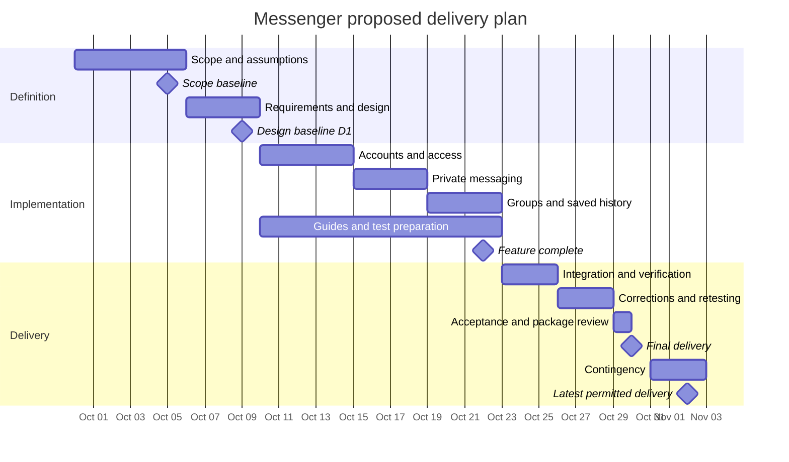

# Statement of Work

## 1.1 Project Purpose
Messenger is a communication application designed to send messages privately between users.

 #### Objectives
 * Send private messages
 * Form a group chat
    
## 1.2 Stakeholders
* User
* Group Chat Admininstrator

## 1.3 Scope

* Create account with unique username and passwords
* Log In/Out Functionality
* User sends a message
* User receive a message
* User create a group chat

## 1.4 Out of Scope

* Voice Messages, Video calls, screen sharing and file attachements
* Editing the message or deletion
* Group leader modify the roles and group chat after created.

## 1.5 Deliverables
| ID  | Reviewable deliverable                                                                                  | Planned completion |
| --- | ------------------------------------------------------------------------------------------------------- | ------------------ |
| D1  | Agreed project definition, requirements baseline, interface/data design notes, and acceptance checklist | October 9          |
| D2  | Working Messenger application in the agreed demonstration environment                                   | October 28         |
| D3  | Source repository, dependency list, database setup, and configuration instructions without credentials  | October 28         |
| D4  | Verification report containing test cases, results, defect corrections, and any remaining limitations   | October 28         |
| D5  | User guide, setup guide, and final demonstration/handover package                                       | October 30         |

## 1.6 Assumptions, constrainsts, and dependencies

### Assumptions requiring confirmation
* Developer can dedicate approximately 15 hours per week to the proposed implementation
* Users will use this app from their desktop browser.

### Constraints
 * The project must be completed no later than November 2. 
### Dependencies
 * Client decision about the proposed boundries and acceptance checklist
 * A working internet browser

## 1.7 Milestones and schedule
| Work or milestone | Dates, inclusive | Dependency or exit condition |
|---|---|---|
| Define scope and resolve assumptions | September 30-October 5 | Client input; scope baseline proposed for October 5 |
| Requirements, design, and acceptance checklist (D1) | October 6-9 | Scope baseline |
| Accounts and access foundation | October 10-14 | Design baseline |
| Private messaging | October 15-18 | Accounts and access foundation |
| Group messaging and saved history | October 19-22 | Working private messaging and shared message storage |
| Draft guides, setup instructions, and tests | October 10-22 | Design baseline; updated alongside features |
| Integrate and verify all features | October 23-25 | Feature-complete application and draft tests |
| Correct defects and repeat affected tests | October 26-28 | Verification results |
| Review release and finalize handover | October 29 | D2-D4 ready; draft guides available |
| Planned final delivery (D5) | October 30 | Acceptance evidence and complete handover package |
| Contingency and latest permitted delivery | October 31-November 2 | Used only if corrections or review require it |

## 1.8 Acceptance

| Deliverable                          | Observable acceptance evidence                                                                                                                                                                                                                                                                                                                   |
| ------------------------------------ | ------------------------------------------------------------------------------------------------------------------------------------------------------------------------------------------------------------------------------------------------------------------------------------------------------------------------------------------------ |
| D1: Definition and design baseline   | A documented review confirms the scope, stakeholders, assumptions, data/interface designs, and acceptance checklist are consistent; unresolved questions have owners and resolution dates.                                                                                                                                                       |
| D2: Working application              | Three test accounts demonstrate registration, login, and logout. User A sends a private message to B; B sees it after refresh, while C is denied access. A creates a group with A, B, and C; all three exchange and retrieve messages. A fourth account outside the group cannot read or send group messages, including through direct requests. |
| D2: Persistence and basic protection | Messages remain after logout/login and an application restart. Empty messages and duplicate usernames are rejected with clear feedback. A code/configuration review confirms passwords are stored as salted password hashes, not plaintext.                                                                                                      |
| D3: Source and setup package         | A reviewer follows the setup guide in the agreed environment, creates the database, and starts the application using the documented dependencies and sample configuration. The repository contains no real credentials.                                                                                                                          |
| D4: Verification report              | Every agreed acceptance test has a recorded result. Failures affecting core messaging, conversation access, or message persistence are corrected and retested before delivery. Remaining minor limitations are explicitly documented for review.                                                                                                 |
| D5: Guides and handover              | The user guide covers all in-scope tasks. The final demonstration follows the acceptance checklist, and the reviewer records acceptance or specific unmet criteria.                                                                                                                                                                              |
